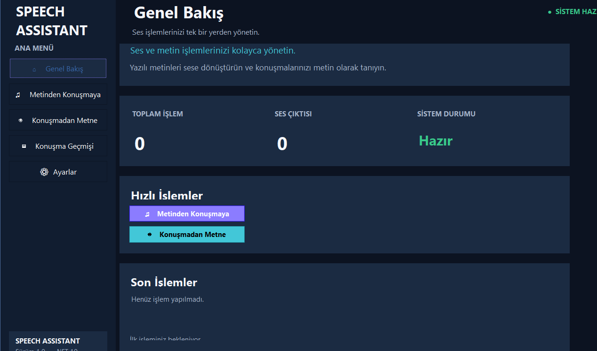
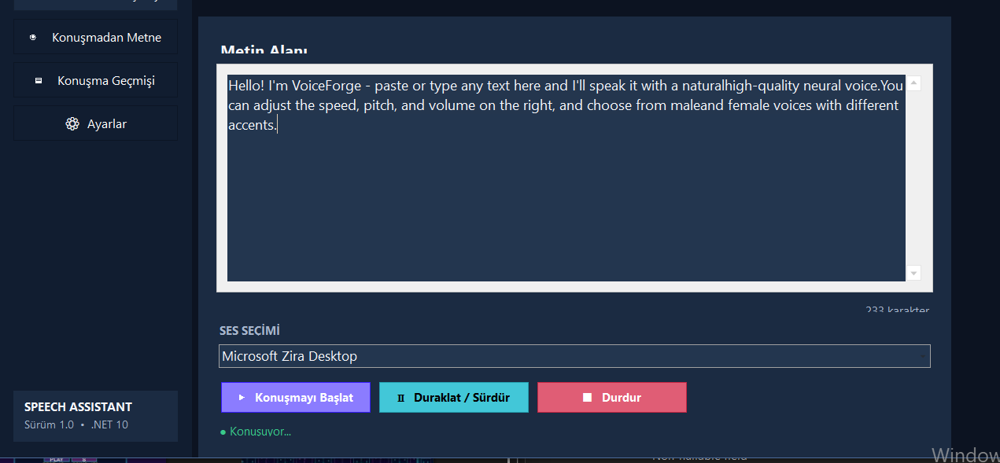

# Speech Assistant

C# ve Windows Speech teknolojileri kullanılarak geliştirilen, metni sese dönüştürme (Text-to-Speech) ve konuşmayı metne dönüştürme (Speech-to-Text) özelliklerine sahip bir Windows masaüstü uygulaması.

Bu proje, Fırat Üniversitesi Yazılım Mühendisliği bölümü **Nesne Tabanlı Programlama (YMH219)** dersi kapsamında geliştirilmiştir.

## Proje Hakkında

Speech Assistant, metin ve ses işlemlerini tek bir masaüstü arayüzü üzerinden gerçekleştirmeyi amaçlar. Uygulama; metinleri sesli olarak oynatma, mikrofon aracılığıyla konuşmayı tanıma ve gerçekleştirilen işlemleri uygulama oturumu boyunca görüntüleme özellikleri sunar.

## Özellikler

### Genel Bakış
- Uygulama işlem istatistiklerini görüntüleme
- Text-to-Speech işlem sayısını takip etme
- Sistem durumunu ve son etkinlikleri görüntüleme
- İlgili bölümlere hızlı erişim

### Metinden Konuşmaya (Text-to-Speech)
- Girilen metni sesli olarak oynatma
- Windows'ta yüklü ses seçeneklerini listeleme
- Konuşmayı başlatma, duraklatma, devam ettirme ve durdurma
- Metnin karakter sayısını görüntüleme

### Konuşmadan Metne (Speech-to-Text)
- Mikrofon üzerinden ses algılama
- Konuşmayı metne dönüştürme
- Windows'ta kullanılabilir konuşma tanıma dillerini listeleme
- Dinleme işlemini başlatma ve durdurma
- Tanınan metni temizleme

### Konuşma Geçmişi
- Gerçekleştirilen TTS ve STT işlemlerini listeleme
- İşlem türünü ve zaman bilgisini görüntüleme
- Geçmiş kayıtlarını temizleme

### Ayarlar
- Uygulama hakkında temel bilgileri görüntüleme

## Kullanılan Teknolojiler

| Teknoloji | Kullanım Alanı |
|---|---|
| C# | Uygulama geliştirme dili |
| .NET 10 | Uygulama platformu |
| Windows Forms | Masaüstü uygulama altyapısı |
| DevExpress WinForms 26.1.6 | Kullanıcı arayüzü bileşenleri |
| System.Speech 11.0.0 | Konuşma tanıma ve ses sentezleme |
| Visual Studio 2026 | Geliştirme ortamı |
| Git & GitHub | Sürüm kontrolü |

## Proje Yapısı

```text
YMH219_SpeechApp/
├── Models/
│   └── SpeechLanguage.cs
├── Services/
│   ├── SpeechRecognitionService.cs
│   └── SpeechSynthesisService.cs
├── Form1.cs
├── Form1.Designer.cs
├── Form1.resx
├── MainForm.cs
├── MainForm.resx
├── Program.cs
├── YMH219_SpeechApp.csproj
└── .gitignore
```

## Kurulum ve Çalıştırma

### Gereksinimler
- Windows 10 veya Windows 11
- .NET 10 SDK ve Windows Desktop çalışma zamanı
- Visual Studio 2026 veya uyumlu bir geliştirme ortamı
- DevExpress WinForms 26.1.6 NuGet paketi
- System.Speech 11.0.0 NuGet paketi
- Speech-to-Text için mikrofon
- Text-to-Speech için ses çıkış cihazı

### Visual Studio ile
1. Bu repository'yi bilgisayarınıza klonlayın.
2. `YMH219_SpeechApp.csproj` dosyasını Visual Studio ile açın.
3. NuGet paketlerinin geri yüklenmesini (Restore) bekleyin.
4. Projeyi derleyin (Build).
5. Uygulamayı çalıştırın (Run).

### Terminal ile

```bash
git clone https://github.com/yaseminu0/YMH219-SpeechApp.git
cd YMH219-SpeechApp
dotnet restore
dotnet build
dotnet run
```

> **Not:** DevExpress paketine erişim için uygun DevExpress NuGet kaynağının yapılandırılmış olması gerekebilir.

## Ekran Görüntüleri

Uygulamaya ait ekran görüntüleri aşağıdaki alanlara eklenecektir.

### Genel Bakış


### Metinden Konuşmaya


### Konuşmadan Metne


## Bilinen Sınırlamalar

- Speech-to-Text özelliği, Windows sisteminde yüklü ve kullanılabilir konuşma tanıma motorlarına bağlıdır.
- Test edilen ortamda konuşma tanıma için `en-US` dili kullanılabilmiştir. Diğer dillerin kullanılabilirliği sistem yapılandırmasına bağlıdır.
- Text-to-Speech ses seçenekleri, Windows sisteminde yüklü olan seslere bağlıdır.
- Konuşma geçmişi bellekte tutulur ve uygulama kapatıldığında silinir.
- Uygulamada kalıcı veritabanı veya kullanıcı kimlik doğrulama sistemi bulunmamaktadır.
- Speech-to-Text özelliğinin kullanılabilmesi için mikrofon erişimi gereklidir.

## Geliştirme Amacı

Bu proje; C# ile masaüstü uygulama geliştirme, nesne tabanlı programlama prensiplerini uygulama, kullanıcı arayüzü tasarlama ve servis sınıfları aracılığıyla Windows Speech teknolojilerini kullanma konularında pratik kazanmak amacıyla geliştirilmiştir.

## Geliştirici

- **Ad Soyad:** [Ad Soyad]
- **Öğrenci Numarası:** [Öğrenci Numarası]
- **Üniversite:** Fırat Üniversitesi
- **Bölüm:** Yazılım Mühendisliği
- **Ders:** Nesne Tabanlı Programlama (YMH219)

---

Bu proje akademik amaçlarla geliştirilmiştir.
